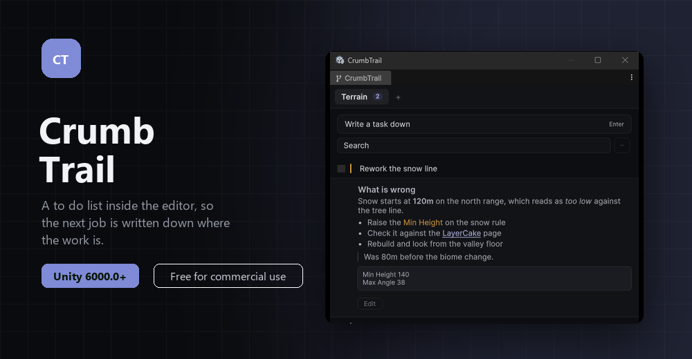

<p align="center">
  
</p>

<h3 align="center">A to do list inside the Unity editor, so the next job is written down where the work is.</h3>

<p align="center">Open it from <b>Window &gt; CookieJarTools &gt; CrumbTrail</b></p>

## Install

Unity 6000.0 or newer.

**In the Package Manager**

1. Open `Window > Package Manager`
2. Press **+**, then **Install package from git URL**
3. Paste this and press Add:

```
https://github.com/CookieJarTools/CrumbTrail.git
```

**Or by hand**, put this line in `Packages/manifest.json`:

```json
"com.cookiejartools.crumbtrail": "https://github.com/CookieJarTools/CrumbTrail.git"
```

## Why a list in here at all

There are already two places to write down what needs doing, and both give something up.

A `// TODO` in the code sits right next to the thing it is about, which is why people read it. But
it has no owner and no priority, it goes stale, and it gets lost in a refactor or left behind in a
file where it no longer applies.

An issue tracker remembers everything and nothing goes stale in it. But nobody opens it while they
are in the middle of a scene, so the small thing you noticed while looking at a mesh does not get
written down at all.

This sits in between. It is tracked, it is in the editor, and a task can point at the thing it is
about, which is the one trick neither of the other two can manage.

## What it does

**One field, one key.** The box at the top is always there and Enter writes the task down. The
reason a list stops being used is almost always the gap between noticing something and getting it
written, so there is nothing in that gap: no dialog, no choosing a list first, no fields to fill.

**A task can point at something.** Select a GameObject, a prefab, a material or a script, and
press the target button on a task. The task wears its name from then on, and clicking that badge
pings it in the project. That is the part a note in a text file cannot do.

**Every task opens into a note, written in Markdown.** Headings, bold, italic, bullets, quotes,
inline code and fenced code all draw, so the detail behind a one line task has somewhere to live
without turning the list itself into an essay. The note shows as drawn text and turns into the raw
Markdown when you click Edit, because a note is read far more often than it is written.

**Lists are tabs, with what is left on them.** The count is the number still to do, which is the
only number worth seeing.

**Priority is a colour, not a word.** A two pixel bar down the left of each task, so a column of
them reads at a glance instead of being read one by one.

**What you can do with a task stays out of sight** until the pointer is on it, so a long list
reads as a list and not as a wall of buttons.

Searching, hiding what is finished, filtering by priority, clearing out the finished ones and
deleting a list all live behind the one menu next to the search box, because a row of toggles
across the top of a to do list is the clutter that stops it being opened.

## Worth knowing

**It saves itself.** Everything is written to `ProjectSettings/CrumbTrail.asset`, so it travels
with the project and goes through version control with it. Nothing has to be saved by hand.

**Tasks are per project, not per scene.** Opening a different scene does not change the list.

**Right click a tab to rename the list.**

**If the CookBook is in the project, `[[Page Name]]` in a note links to that page** and opens it
when clicked. CrumbTrail does not depend on the CookBook: the part that knows about it is a
separate assembly that only builds when the CookBook is installed, and a page link says plainly
what is missing when it is not.

## Licence

Free to use, including in games you sell, under the PolyForm Shield License 1.0.0.
The one thing it does not allow is using it to make something that competes with the
tool itself. See [LICENSE.md](LICENSE.md).
